  
  
  
  
  

## Hi, I'm Tarun

I'm a Data Science grad student at **Rutgers University–Camden**, building machine learning and GenAI projects end to end — data prep, feature engineering, modeling, evaluation, deployment. Lately I've been drawn to a harder question: *can you actually trust this model, this dataset, this agent?* Most of what I'm building now tries to answer it.

I also teach data science to beginners on YouTube at **[The Outliers Club](https://www.youtube.com/@TheOutliersClub)**.

- 🎓 &nbsp;MS Data Science @ Rutgers–Camden (2025–27, 4.0 GPA) · B.Tech CSE @ SRM University AP
- 🔬 &nbsp;Building **[skill-bench](https://github.com/Tarunvaka/skill-bench)**, a pre-registered A/B test of whether Claude Code skills actually work
- 🎥 &nbsp;40+ videos and 4 course playlists on The Outliers Club
- 📫 &nbsp;Have an opportunity or want to build something together? **tarunvaka2003@gmail.com**

## Featured work

<table>
<tr>
<td width="50%" valign="top">

**[dataset-doctor](https://github.com/Tarunvaka/dataset-doctor)** 
Catch the data leak before it ships. An agent skill that checks a tabular dataset *before* you train — target leakage, ID columns, train/test overlap, quality issues — and tells you what to drop. Runs in Claude Code, Cursor, Codex CLI, and Gemini CLI.

`Python` `pandas` `scikit-learn` `Agent Skills`

</td>
<td width="50%" valign="top">

**[skill-bench](https://github.com/Tarunvaka/skill-bench)** 
Do Claude Code skills actually work? Same task, same model, with and without the skill, scored by deterministic graders. No LLM-as-judge, protocol published before the full run, raw transcripts for every number.

`Python` `Claude Code` `experiment design`

</td>
</tr>
<tr>
<td width="50%" valign="top">

**[AI Voice Assistant with RAG](https://github.com/Tarunvaka/AI-Voice-Assistant-with-RAG-Pipeline)** 
Real-time voice assistant with memory. Faster-Whisper turns speech into text, Mistral (via Ollama) answers, and a Qdrant vector store keeps context across the conversation.

`Python` `Whisper` `Ollama` `Qdrant`

</td>
<td width="50%" valign="top">

**[Multi-Modal PDF Search](https://github.com/Tarunvaka/LangChain-Based-Multi-Modal-PDF-Search-Engine)** 
Ask questions about a PDF and get answers drawn from its text, tables, *and* images. Parses with `unstructured`, retrieves from ChromaDB, chains it together with LangChain.

`LangChain` `ChromaDB` `unstructured` `RAG`

</td>
</tr>
<tr>
<td width="50%" valign="top">

**[Image Captioning](https://github.com/Tarunvaka/image-captioning-vgg16-lstm)** 
VGG16 encoder + LSTM decoder trained on Flickr8k, served through a Flask app that captions any image you upload.

`TensorFlow` `Keras` `Flask`

</td>
<td width="50%" valign="top">

**[Image Super-Resolution](https://github.com/Tarunvaka/image-super-resolution)** 
A convolutional autoencoder that learns to map low-resolution images to sharp, high-resolution ones.

`TensorFlow` `Keras` `computer vision`

</td>
</tr>
</table>

More projects and certifications → <a href="https://tarunvaka.com/projects">tarunvaka.com/projects</a>

## Experience

| Role | Where | When |
| :-- | :-- | :-- |
| Content Creator | The Outliers Club · YouTube | Nov 2024 – now |
| Associate, McCarthy Lab | Next Tech Lab | Feb 2024 – May 2025 |
| Chegg Expert | Chegg India | Feb – Apr 2024 |
| Data Analyst Intern | APSSDC | Jun – Aug 2023 |

## Toolbox

  

**ML & data** &nbsp;pandas · NumPy · scikit-learn · TensorFlow / Keras · Matplotlib · Seaborn 
**GenAI** &nbsp;LangChain · RAG · Ollama · Whisper · Qdrant · ChromaDB · Claude Code 
**Certified** &nbsp;TensorFlow Developer (DeepLearning.AI, Zero To Mastery) · Machine Learning (Stanford)

---

Teaching on <a href="https://www.youtube.com/@TheOutliersClub">The Outliers Club</a> · everything else at <a href="https://tarunvaka.com">tarunvaka.com</a>

